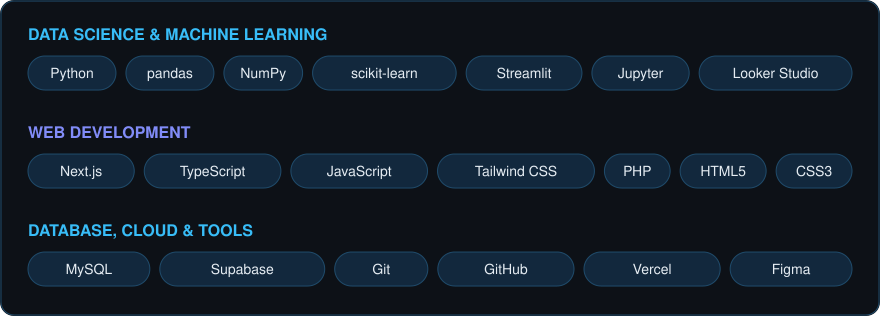

<div align="center">

  <a href="https://github.com/muhanggaraaa">
    
  </a>

  <br/>

  <a href="https://github.com/muhanggaraaa">
    
  </a>

</div>


I'm a final-year Informatics student at UNTIRTA. I got into data science the long way: computer networks first, then web development and UI/UX, now data. Because of that path, I tend to carry an analysis all the way to something people can open and use, not stop at a chart in a notebook.

```python
class Anggara:
    def __init__(self):
        self.name = "Muhamad Anggara Ramadhan"
        self.location = "Cilegon, Indonesia 🇮🇩"
        self.education = "S1 Informatics, Universitas Sultan Ageng Tirtayasa (UNTIRTA)"
        self.current_role = "Data Science Specialist Cohort, Asah 2026 (Dicoding & GoTo)"
        self.previous_exp = "Web Dev & UI/UX Independent Study, VINIX7"
```

**🧠 What I'm into**

- Machine learning and NLP, especially for Indonesian text
- Data storytelling: turning tables into decisions
- Shipping small tools that solve one real problem well

**⚡ Quick facts**

- 📍 Based in Cilegon, Indonesia
- 💬 Ask me about Python, SQL, scikit-learn, or Streamlit
- 🤝 Open to internships and collaborations in data


- 🏪 A stock recording and purchase recommendation system for **Ayam Geprek Sarjana (KOPMA UNY)** - capstone project at Asah 2026 with team A26-CS281. My part is the data side: wrangling, exploration, and descriptive analysis
- 🎬 [Movie Recommender System](https://github.com/muhanggaraaa/movie-recommender-system) - item-based collaborative filtering on MovieLens 100K, RMSE 0.861 vs 1.049 for the dumb baseline
- 📰 An Indonesian hoax news detector - logistic regression on 33,695 news articles, 87.7% test accuracy





<div align="center">
  
</div>


<div align="center">

[LinkedIn](https://www.linkedin.com/in/muhamad-anggara-ramadhan/) · [Portfolio](https://muhanggaraaa.web.id) · [Email](mailto:muh.anggaraaa@gmail.com) · [YouTube](https://www.youtube.com/@muh.anggaraaa)

</div>
